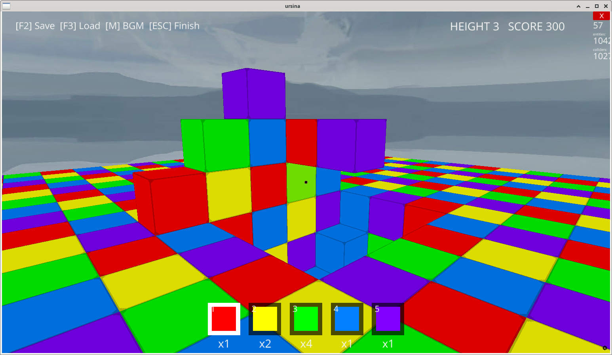

# Block Sandbox

A 3D Block Sandbox Game

## 1. About the Game

This is a 3D block sandbox game developed using Python and the Ursina Engine.

You can place and break blocks in five colors: red, yellow, green, blue, and purple.

Broken blocks are added to your inventory.

An indestructible bedrock layer lies at the bottom of the world.



## 2. File Structure

After extracting the distribution archive, the files should be organized as follows:

```text
BlockSandbox/
    block_sandbox.py
    README.txt
```

## 3. Requirements

The following software and hardware are required to run this game:

- Python 3
- Ursina Engine
- A system capable of running 3D graphics

The game is intended to run on Windows and Linux. However, operation is not guaranteed on every system.

## 4. How to Run on Windows

### Step 1: Install Python

Download Python from the official website:

https://www.python.org/downloads/

If the option "Add Python to PATH" appears during installation, make sure to check it.

### Step 2: Open the Game Folder

Open the folder containing `block_sandbox.py`.

Type `cmd` in the File Explorer address bar and press Enter to open Command Prompt in that folder.

### Step 3: Create a Virtual Environment

Run the following command:

```powershell
py -m venv .venv
```

### Step 4: Activate the Virtual Environment

```powershell
.venv\Scripts\activate
```

### Step 5: Install Ursina

Run the following commands:

```bash
python -m pip install --upgrade pip
python -m pip install ursina
```

Wait for the installation to finish.

### Step 6: Launch the Game

```bash
python block_sandbox.py
```

If the game window appears, the installation was successful.

## 5. How to Run on Linux

### Step 1: Install Python and Virtual Environment Support

You need Python and virtual environment support. On Arch Linux and other distributions, the required packages may already be installed.

On Ubuntu-based systems, run the following command if necessary:

```bash
sudo apt install python3 python3-venv python3-pip
```

### Step 2: Navigate to the Game Folder

```bash
cd BlockSandbox
```

Adjust the folder name to match the actual directory.

### Step 3: Create a Virtual Environment

```bash
python3 -m venv .venv
```

### Step 4: Activate the Virtual Environment

```bash
source .venv/bin/activate
```

### Step 5: Install Ursina

Run the following commands:

```bash
python -m pip install --upgrade pip
python -m pip install ursina
```

### Step 6: Launch the Game

```bash
python block_sandbox.py
```

## 6. Controls

- **W / A / S / D:** Move
- **Mouse:** Look around
- **Space:** Jump
- **Left Mouse Button:** Place a block
- **Right Mouse Button:** Break a block
- **F2:** Save the world
- **F3:** Load the world
- **M:** Toggle background music
- **Esc:** Quit the game

## 7. Save Data

When you save your game, a file named `savegame.json` is created.

If you want to keep your saved world, do not delete this file.

If you move the game folder or change its storage location, make sure to check where the save data is stored.

## 8. Troubleshooting

### Ursina Cannot Be Found

Run the following command to install Ursina:

```bash
python -m pip install ursina
```

If you are using a virtual environment, activate it before running the command.

### Python Cannot Be Found

On Windows, check that Python is installed correctly and that PATH is configured properly.

### The Game Window Does Not Appear

Check your graphics environment, required libraries, and Python version.

If an error message appears, review it to identify the cause.

## 9. License

This project is licensed under the MIT License.

You are free to use, copy, modify, and distribute this software, including for commercial purposes, provided that the original copyright notice and license text are included.

See the [LICENSE](LICENSE) file for the full license text.

## 10. A Note from the Author

Thank you for playing this game!

Feedback, reports about compatibility, and bug reports are welcome.
